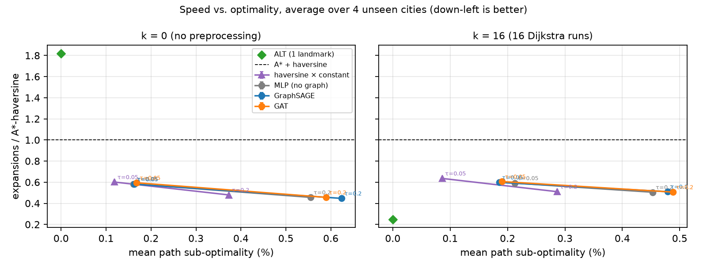
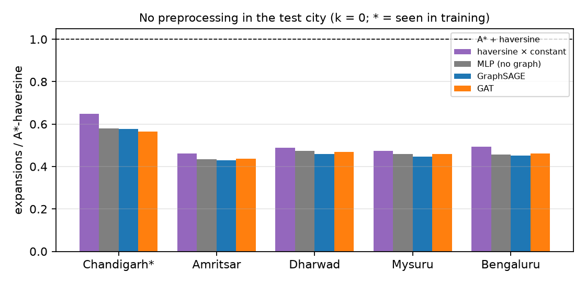

# Do Graph Neural Networks Learn Better A\* Heuristics on Indian Road Networks?

**Mehtab Singh** · M.Tech Data Science & AI, IIIT Dharwad · report: [`report/gnn_astar_report.pdf`](report/gnn_astar_report.pdf)

> **Short answer: not better than a well-calibrated constant.** Learned heuristics make A\* expand **~2× fewer nodes** than the standard straight-line heuristic with **no preprocessing** in a new city, at the cost of paths about **0.5% longer** than optimal. But a single detour-ratio constant does the same, and graph message passing (GraphSAGE, GAT) is no better than an MLP. With **≥ 8 Dijkstra runs** of preprocessing, the classical **ALT** algorithm beats all of them **and stays exactly optimal**.

## TL;DR

On 8 OpenStreetMap road networks of Indian cities (up to 26k nodes), we trained GNN heuristics on 3 Punjab cities and tested them on 4 **unseen** cities (1 in Punjab, 3 in Karnataka). Each method gets the same **preprocessing budget k** of single-source Dijkstra runs in the new city (k = 0 to 16).

| Unseen-city average (150 queries each) | Expansions vs. A\* + haversine | Path sub-optimality |
|---|---|---|
| Dijkstra | 5.53× | 0% |
| A\* + haversine (standard) | 1.00× | 0% |
| **GraphSAGE**, zero-shot (k = 0, τ = 0.2) | **0.45× ± 0.01** | 0.62% |
| MLP, no graph (k = 0) | 0.46× | 0.56% |
| haversine × one constant (k = 0) | 0.48× | 0.37% |
| ALT, 4 landmarks (k = 4) | 0.50× | **0%** |
| ALT, 8 landmarks (k = 8) | **0.35×** | **0%** |
| ALT, 16 landmarks (k = 16) | **0.25×** | **0%** |

## 1. Question

A\* finds shortest paths faster when its heuristic h(v) (an estimate of the remaining distance) is closer to the truth. The standard choice on road maps is the straight-line (haversine) distance: always a lower bound, so the path is optimal, but often loose. Recent work learns heuristics with neural networks. We ask:

1. Can a GNN learn a heuristic that transfers to **cities it has never seen**?
2. Does **graph structure** help, compared with an MLP and with a one-number baseline?
3. How much **preprocessing** in a new city does the classical ALT algorithm need before it wins?

## 2. Method

**Graphs.** Drivable OpenStreetMap network within 5 km of each city centre ([OSMnx](https://osmnx.readthedocs.io)), made undirected and reduced to its largest connected component.

| City | Role | Nodes | Edges |
|---|---|---|---|
| Chandigarh, Ludhiana, Jalandhar | training | 12,096 / 26,442 / 22,944 | 16,931 / 37,946 / 31,661 |
| Patiala | validation (chooses τ) | 13,062 | 18,176 |
| Chandigarh | test, seen city (new queries) | 12,096 | 16,931 |
| Amritsar | test, unseen (Punjab) | 19,117 | 26,107 |
| Dharwad, Mysuru, Bengaluru | test, unseen (Karnataka) | 4,958 / 18,557 / 26,386 | 6,781 / 27,887 / 37,650 |

**Learned heuristic.** Predict the detour ratio r(v, t) = road distance / straight-line distance and use h(v) = haversine(v, t) × r̂(v, t). The ratio is scale-free, so it can transfer between cities. A 3-layer encoder (MLP, GraphSAGE or GATv2, about 55–68k parameters, [PyTorch Geometric](https://pyg.org)) embeds every node from city-invariant features (relative position, degree, edge lengths). A pair head then predicts log r from the two node embeddings and the straight-line geometry. Labels are exact: one Dijkstra from each of 150 random targets per training city gives the true distance from every node.

**Quantile loss.** Training uses the pinball loss at quantile τ, so the model deliberately under-predicts the detour τ of the time. A smaller τ means fewer over-estimates, so fewer sub-optimal paths but more search. τ ∈ {0.05, 0.2} was trained, and τ was chosen **on the validation city only** (fewest expansions with sub-optimality ≤ 1%), which gave τ = 0.2 for every method.

**Baselines, under equal budget k** (single-source Dijkstra runs in the test city):

| Method | k = 0 | k > 0 |
|---|---|---|
| A\* + haversine | standard | – |
| ALT (Goldberg & Harrelson, 2005) | – | k landmarks (farthest-point), exact |
| haversine × constant | τ-quantile ratio from training cities | τ-quantile ratio measured on k runs |
| learned (MLP / GraphSAGE / GAT) | zero-shot | fine-tuned on k runs (100 steps) |

**Protocol.** 150 random queries per city (straight-line distance ≥ 1 km), identical for all methods. Every method uses one shared A\* implementation, which re-opens closed nodes, so it stays correct for inconsistent heuristics. We report node expansions relative to A\* + haversine (geometric mean), and sub-optimality = returned path length / optimal − 1. All learned results are mean ± std over **3 training seeds**. Everything ran on a laptop (GTX 1660 Ti): training takes 15–65 s per model, and the full evaluation about 30 minutes.

## 3. Results

Full tables (every city, budget and τ): [`results/RESULTS.md`](results/RESULTS.md) · headline numbers: [`results/summary.json`](results/summary.json).






### Key findings

1. **Inadmissible heuristics halve the search with almost no loss in path quality.** With no preprocessing in an unseen city, every learned model cuts node expansions to 0.45–0.46× of haversine A\*, with paths 0.56–0.62% longer than optimal on average.
2. **…but learning is not what makes the difference.** Multiplying haversine by a single constant detour ratio (estimated on the training cities) reaches 0.48× at 0.37% sub-optimality. At matched path quality the methods coincide: at τ = 0.05 the constant gives 0.60× at 0.12%, and GraphSAGE gives 0.58× at 0.16% (trade-off figure). The reason is that the detour ratio is remarkably uniform across Indian cities: its 20th percentile is 1.14–1.18 in every test city, and 1.17 on the training cities.
3. **Graph structure did not help meaningfully.** GraphSAGE (0.45×) and GAT (0.46×) were within 0.01 of an MLP that sees no neighbours (0.46×) in every unseen city, which is inside the seed-to-seed spread (± 0.01–0.02).
4. **Fine-tuning helps only in a city seen during training.** In Chandigarh, fine-tuning on 16 Dijkstra runs brings the learned models to 0.41–0.45×, against 0.56× for the constant at similar sub-optimality (about 0.8%). In unseen cities, fine-tuning on k = 2 or 16 runs did not reduce expansions (GraphSAGE 0.45× → 0.51× at k = 16, with sub-optimality 0.62% → 0.48%). It mainly re-calibrated the model along the same trade-off.
5. **ALT needs a few landmarks, then dominates.** With 1–2 landmarks ALT is *worse* than haversine (1.82× and 1.08×), because one or two landmarks give poor bounds for most targets. At 4 landmarks it ties the learned models (0.50×), and with 8 and 16 it wins clearly (0.35× and 0.25×) while staying exactly optimal. Its preprocessing is at most 0.1 s per city at this scale.

**Take-away.** For city-scale road networks, a learned heuristic is only worth it when *no* preprocessing is possible, and even then a calibrated constant is an equally strong, far simpler choice. With more than a handful of Dijkstra runs available, classical ALT is better on every metric we measured.

## 4. Limitations

- Graphs are 5 km city cores (5k–26k nodes). On country-scale graphs, ALT's memory (k distances per node) and preprocessing grow, which may change the comparison.
- Expansions are a hardware-independent cost. In wall-clock time (pure-Python A\*, unseen cities) a query takes 24 ms with haversine, 21 ms with GraphSAGE (12 ms search + 9 ms to evaluate the model for the target), 14 ms with the constant and 10 ms with ALT-16, so the model's per-target forward pass cancels most of its search savings.
- Only distance (not travel time) is used, and one-way streets are ignored (undirected graphs).
- Two τ values and one architecture size were tried, so a much larger model or different features could behave differently.

## 5. Reproduce

```bash
pip install -r requirements.txt
pytest -q                               # 5 tests on a synthetic grid (no download)
python scripts/download.py              # fetch 8 cities from OpenStreetMap (needs internet)
python scripts/run_all.py               # train 18 models + evaluate 6 cities + aggregate (~40 min)
python scripts/run_all.py --quick       # tiny smoke run
```

```
src/gnnastar/   graphs.py (OSM download, CSR graph) · search.py (A*, ALT) · model.py (MLP/SAGE/GAT heuristic)
                train.py (exact labels, pinball loss, fine-tuning) · evaluate.py (budgets, queries)
scripts/        download.py · run_all.py · aggregate.py (tables, figures, summary.json)
results/        eval/*.csv (one row per query × method) · models/ · figures/ · RESULTS.md
```

## References

- A. Goldberg, C. Harrelson. *Computing the Shortest Path: A\* Search Meets Graph Theory.* SODA 2005.
- W. Hamilton, R. Ying, J. Leskovec. *Inductive Representation Learning on Large Graphs (GraphSAGE).* NeurIPS 2017.
- S. Brody, U. Alon, E. Yahav. *How Attentive are Graph Attention Networks? (GATv2).* ICLR 2022.
- G. Boeing. *OSMnx: New Methods for Acquiring, Constructing, Analyzing, and Visualizing Complex Street Networks.* 2017.
- P. Hart, N. Nilsson, B. Raphael. *A Formal Basis for the Heuristic Determination of Minimum Cost Paths.* 1968.
