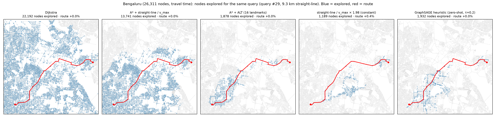
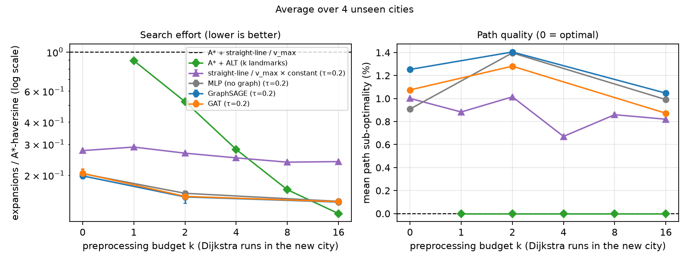
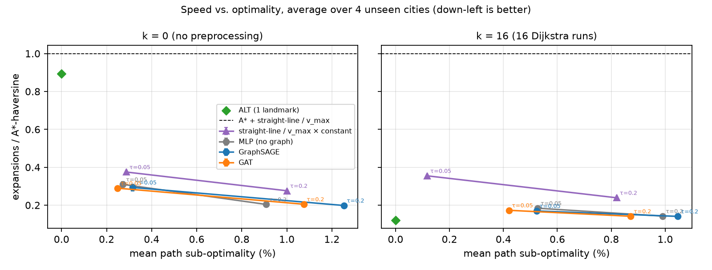
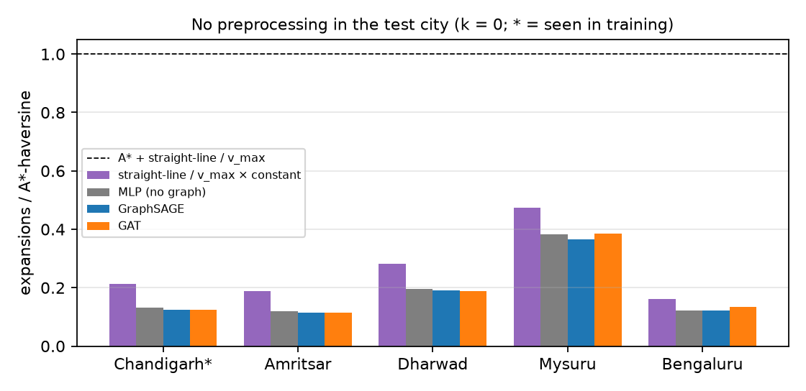
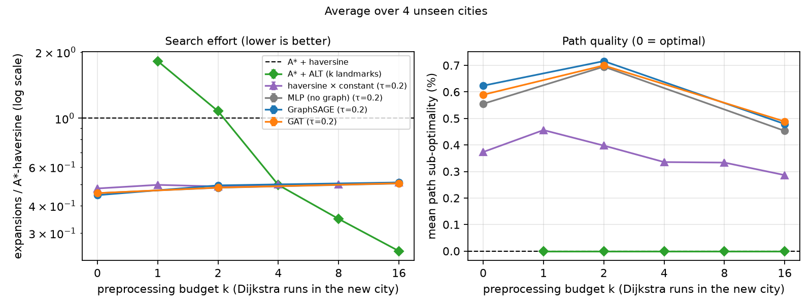

# When Do Learned A\* Heuristics Pay Off? A Budget-Controlled Study on Indian Road Networks

**Mehtab Singh** · M.Tech Data Science & AI, IIIT Dharwad · report: [`report/gnn_astar_report.pdf`](report/gnn_astar_report.pdf)


*The same 9.3 km query in Bengaluru (26k nodes, travel time). Blue = nodes each method explores before finding the red route. The query was picked by a fixed rule (median of the 20 longest random queries), not chosen to flatter any method.*

## TL;DR

We ask when a learned heuristic beats classical ones for A\* search, giving every method **the same preprocessing budget k** (Dijkstra runs in a city it has never seen). Models are trained on 3 Punjab cities and tested on **4 unseen cities** (Amritsar; Dharwad, Mysuru and Bengaluru in Karnataka), over **two studies and 3,600 queries**. The answer depends on the cost function:

| | Study 1: distance, undirected | **Study 2: travel time, one-way streets** |
|---|---|---|
| Learned heuristic, no preprocessing | 0.45× expansions, +0.6% path | **0.20× expansions, +0.9% path** |
| Same, fine-tuned on 2 Dijkstra runs | 0.48×, +0.7% | **0.15×, +1.4%** |
| Best constant (one detour factor) | 0.48×, +0.4% (**ties**) | 0.28×, +1.0% (**loses**) |
| ALT, 2 / 8 / 16 landmarks (exact) | 1.08× / 0.35× / 0.25× | 0.52× / 0.17× / 0.12× |
| GNN (GraphSAGE, GAT) vs. MLP | no difference | no difference |

*Expansions are relative to A\* with the standard admissible straight-line heuristic (lower is better); path = average extra length or time compared with the optimal route. Unseen-city averages, learned models are the mean of 3 seeds.*

**Findings.**
1. **With realistic travel-time costs, learning clearly helps.** A zero-shot learned heuristic explores **5× fewer nodes** than standard A\* at ~1% longer routes. It beats the best constant on *both* effort and path quality in 3 of 4 unseen cities, and at equal path quality (≈ 0.3% longer) it explores **16–22% fewer nodes**.
2. **With plain distance, it doesn't.** One constant detour factor matches every learned model, because road-to-straight-line detours are nearly identical across Indian cities (20th percentile 1.14–1.18). Travel-time detours are not (calibrated factor 1.79–2.96 across cities), which leaves room to learn.
3. **Learning wins only at small preprocessing budgets.** With ≤ 2 Dijkstra runs a fine-tuned model explores 3.5× fewer nodes than ALT (0.15× against 0.52×). ALT catches up at 8 landmarks and wins at 16 (0.12×), while always returning the optimal route.
4. **Graph message passing added nothing.** GraphSAGE and GAT were within seed noise of an MLP on node features in both studies: local road-class features were enough.
5. **At city scale the picture shifts again** (53k- and 134k-node graphs, 10–12 km). With 16 Dijkstra runs, fine-tuned models explore **13–33% fewer nodes than ALT-16** (at ~1% longer routes), because 16 landmarks cover a big city less well. Zero-shot transfer **breaks** on 12 km Bengaluru, whose 120 km/h road doubles the looseness of the bound; one Dijkstra run in the new city fixes it.

## 1. Question

A\* finds shortest routes faster when its heuristic h(v), an estimate of the remaining cost to the target, is tight. The standard admissible choice, straight-line distance (divided by the top speed for travel time), never over-estimates, so routes are optimal, but it is loose, especially for travel time. Learned heuristics promise tighter estimates. Most papers, however, compare them only with the straight-line bound, not with strong classical methods given the same preprocessing. We ask:

1. Does a learned heuristic **transfer to unseen cities**?
2. Does it beat a **one-number baseline** and **ALT** under an **equal preprocessing budget**?
3. Does **graph structure** (GNN message passing) help over an MLP?
4. How do the answers change between **distance** and **travel time with one-way streets**?

## 2. Method

**Graphs.** The OpenStreetMap drivable network within 5 km of each city centre, from [OSMnx](https://osmnx.readthedocs.io).
- **Study 1:** undirected graphs, cost = length.
- **Study 2:** directed graphs (one-way streets kept), cost = free-flow travel time from OSM `maxspeed` tags. Where a tag is missing (most roads in India), a road-class default is used (motorway 80 … residential 20 km/h). Each graph is reduced to its largest strongly connected component.

| City | Role | Study 2 nodes / directed edges |
|---|---|---|
| Chandigarh, Ludhiana, Jalandhar | training (Chandigarh also tested with new queries) | 12,019 / 30,689 · 26,422 / 73,460 · 22,827 / 61,298 |
| Patiala | validation, used only to choose τ | 13,054 / 35,417 |
| Amritsar | test, unseen (Punjab) | 19,051 / 49,950 |
| Dharwad · Mysuru · Bengaluru | test, unseen (Karnataka, another region) | 4,947 / 13,341 · 18,548 / 53,639 · 26,311 / 69,417 |

**Learned heuristic.** Predict the detour ratio r = true cost / admissible straight-line bound, and use h = bound × r̂.
- A 3-layer encoder embeds every node: MLP (no message passing), GraphSAGE or GATv2, 55–68k parameters, in [PyTorch Geometric](https://pyg.org).
- Node features are city-invariant: relative position, degree, edge lengths, and in Study 2 also mean/max incident speed, share of fast roads and one-way imbalance.
- A pair head predicts log r̂ from both embeddings, the straight-line geometry and the city's top speed.
- Labels are exact: one Dijkstra per target gives the true cost from every node (150 targets per training city).

**Quantile loss.** We use the pinball loss at quantile τ ∈ {0.05, 0.2}. A lower τ makes the model under-predict more often, which gives fewer over-long routes but more search. τ was chosen on the validation city only (fewest expansions with ≤ 1% sub-optimality); it came out as τ = 0.2 for every method in both studies.

**Equal budget k** = single-source Dijkstra runs allowed in the new city:

| Method | k = 0 | k > 0 |
|---|---|---|
| A\* + straight-line bound | standard, exact | – |
| ALT (Goldberg & Harrelson 2005) | – | k farthest-point landmarks; exact, directed version uses distances to and from each landmark |
| bound × constant | τ-quantile ratio from training cities | τ-quantile ratio measured on k runs |
| learned (MLP / GraphSAGE / GAT) | zero-shot | fine-tuned on the same k runs (100 steps) |

**Protocol.**
- 150 random queries per city (straight-line ≥ 1 km), identical for every method.
- Calibration and query targets are disjoint.
- One shared A\* implementation, which re-opens closed nodes, so it stays correct for inconsistent heuristics.
- Metrics: node expansions relative to standard A\* (geometric mean over queries), and sub-optimality = route cost / optimal − 1.
- Learned models: **3 training seeds**, reported as mean ± std.
- Hardware: one laptop GPU (GTX 1660 Ti). Training takes 13–66 s per model, evaluation about 30 minutes per study.

## 3. Results

Full tables (every city, budget and τ): Study 2 [`results/time/RESULTS.md`](results/time/RESULTS.md) · Study 1 [`results/RESULTS.md`](results/RESULTS.md). Headline numbers: [`results/time/summary.json`](results/time/summary.json), [`results/summary.json`](results/summary.json).

### Study 2: travel time, one-way streets

| Unseen-city average | k = 0 | k = 2 | k = 4 | k = 8 | k = 16 |
|---|---|---|---|---|---|
| Dijkstra | 2.23× (exact) | | | | |
| A\* + straight-line / v_max | 1.00× (exact) | | | | |
| A\* + ALT (k landmarks) | – | 0.52× (exact) | 0.28× (exact) | **0.17× (exact)** | **0.12× (exact)** |
| straight-line / v_max × constant | 0.28× (+1.00%) | 0.27× (+1.01%) | 0.25× (+0.67%) | 0.24× (+0.86%) | 0.24× (+0.82%) |
| MLP (no graph) | **0.20× ± 0.01** (+0.91%) | **0.16×** (+1.40%) | – | – | 0.14× (+0.99%) |
| GraphSAGE | **0.20× ± 0.01** (+1.25%) | **0.15×** (+1.40%) | – | – | 0.14× (+1.05%) |
| GAT | 0.21× ± 0.01 (+1.08%) | **0.15×** (+1.28%) | – | – | 0.14× (+0.87%) |







### City-scale test (Study 2 settings, 60 queries per graph, τ = 0.2)

Same trained models, no retraining, on much larger graphs: **Ludhiana 10 km** (53,214 nodes; contains the 5 km training core) and **Bengaluru 12 km** (134,415 nodes, 5× the largest training graph).

| Method | Ludhiana 10 km, k = 0 | k = 16 | Bengaluru 12 km, k = 0 | k = 2 | k = 16 |
|---|---|---|---|---|---|
| A\* + ALT (16 landmarks) | – | 0.13× (exact) | – | 0.29× (2 lm, exact) | 0.085× (exact) |
| straight-line / v_max × constant | 0.17× (+1.15%) | 0.19× (+0.71%) | 0.55× (+0.00%) | 0.08× (+2.13%) | 0.11× (+0.78%) |
| MLP | **0.12×** (+1.42%) | **0.11×** (+0.86%) | 0.44× (+0.03%) | 0.12× (+1.53%) | **0.064×** (+1.33%) |
| GraphSAGE | 0.13× (+2.21%) | **0.11×** (+0.97%) | 0.40× (+0.06%) | 0.13× (+0.88%) | **0.057×** (+1.69%) |
| GAT | **0.12×** (+1.57%) | 0.12× (+1.05%) | 0.43× (+0.07%) | 0.13× (+0.67%) | **0.057×** (+1.17%) |

- **Fine-tuned learned heuristics beat ALT-16 at scale:** 0.106–0.116× vs. 0.134× in Ludhiana and 0.057–0.064× vs. 0.085× in Bengaluru, i.e. 13–33% fewer expansions, at about 1% longer routes (ALT stays exact). On the 5 km cores ALT-16 won (0.12× vs. 0.14×).
- **Zero-shot fails under a top-speed shift.** Every training city tops out at 60 km/h. The 12 km Bengaluru graph contains a road at 120 km/h, so the straight-line / v_max bound becomes twice as loose: the calibrated detour factor jumps from 1.98 (training cities) to 3.4. The k = 0 constant and the zero-shot models under-scale and stay near-exact but slow (0.40–0.55×). A single Dijkstra run re-calibrates the constant (0.08×), and the models recover after fine-tuning.
- Preprocessing cost grows with graph size: ALT-16 takes 1.5 s on Bengaluru 12 km, fine-tuning a model on 16 runs 22 s (MLP) to 140 s (GAT) in this Python implementation.

### Study 1: distance, undirected

| Unseen-city average | k = 0 | k = 2 | k = 8 | k = 16 |
|---|---|---|---|---|
| A\* + ALT | – | 1.08× (exact) | 0.35× (exact) | 0.25× (exact) |
| haversine × constant | 0.48× (+0.37%) | 0.49× (+0.40%) | 0.50× (+0.33%) | 0.51× (+0.29%) |
| MLP / GraphSAGE / GAT | 0.45–0.46× (+0.6%) | 0.48–0.49× (+0.7%) | – | 0.50–0.51× (+0.5%) |

 

### Key findings (with evidence)

1. **Travel time: learning beats the constant, city by city.** At k = 0 (no preprocessing), the MLP and the constant score as follows. The learned model is better on both axes in three of the four unseen cities. Bengaluru is a trade-off: fewer nodes, but longer routes.

   | City | MLP | Constant |
   |---|---|---|
   | Amritsar | 0.12× (+0.89%) | 0.19× (+1.46%) |
   | Dharwad | 0.19× (+1.18%) | 0.28× (+1.65%) |
   | Mysuru | 0.38× (+0.05%) | 0.47× (+0.00%) |
   | Bengaluru | 0.12× (+1.51%) | 0.16× (+0.89%) |

   At matched quality (τ = 0.05) the learned models reach 0.29–0.31× at +0.25–0.32%, against 0.37× at +0.29% for the constant: **16–22% fewer expansions at equal path quality**.
2. **Why the two studies differ.** The detour factor of the constant baseline, calibrated per city, is almost the same everywhere for distance (1.14–1.18), but varies widely for travel time (1.79–2.96). With travel time, how slow the path to the target is depends on *where* you are (arterials vs. residential lanes), and road-class features capture that.
3. **Fine-tuning pays off in Study 2 only.** Fine-tuning on 2 Dijkstra runs takes learned models from 0.20× to 0.15×, and on 16 runs to 0.14× (at +0.9–1.1%). The calibrated constant stays at 0.24–0.27×. In Study 1, fine-tuning mostly moved models along the same trade-off.
4. **ALT is the right tool once you can afford 8+ Dijkstra runs.** With 1–2 landmarks ALT is weak (Study 2: 0.89× and 0.52×). With 8 it matches the fine-tuned learned model (0.17× against 0.15×), and with 16 it wins (0.12×), with optimal routes and 0.02–0.12 s of preprocessing per city.
5. **Message passing did not help.** In both studies GraphSAGE and GAT were within ±0.01 of the MLP, which is inside the seed-to-seed spread. Hand-built road-class node features carried the useful signal.

**Take-away.** If you can preprocess a new city with 8–16 Dijkstra runs, use ALT. If you can't (a new city, a changed road network, very limited memory or time), a learned detour-ratio heuristic gives large savings for realistic travel-time costs, but a GNN is not needed: an MLP on local road features is as good.

## 4. Limitations

- **Scale:** the main results use 5 km city cores (5k–26k nodes). The city-scale test covers only two graphs (53k and 134k nodes) with 60 queries each and the selected τ; the Ludhiana 10 km graph also contains the training core, so only Bengaluru 12 km is fully unseen.
- **Top-speed shift:** all training cities have the same top speed (60 km/h), so the model never learned to use the top-speed feature; training on cities with motorways would be needed for zero-shot transfer to them.
- **Speeds** are free-flow and mostly road-class defaults: few Indian roads carry `maxspeed` tags. There is no live traffic and there are no turn costs.
- **Wall-clock time** (pure Python A\*): the per-target forward pass of the model costs about 9 ms, so in this implementation the time savings are smaller than the savings in expansions. Expansions are the hardware-independent measure.
- Two τ values and one model size were tried.

## 5. Reproduce

```bash
pip install -r requirements.txt
pytest -q                                          # 7 tests incl. directed ALT exactness (no download)
python scripts/download.py                         # study 1 graphs (OpenStreetMap, needs internet)
python scripts/download.py --mode time             # study 2 graphs
python scripts/run_all.py                          # study 1 -> results/         (~40 min)
python scripts/download.py --mode time ludhiana_xl bengaluru_xl   # city-scale graphs (optional)
python scripts/run_all.py --mode time              # study 2 -> results/time/    (~45 min; +45 min for city-scale graphs if downloaded)
python scripts/frontier_map.py --mode time --city bengaluru
```

```
src/gnnastar/   graphs.py (OSM download; distance or travel-time CSR graphs) · search.py (A*, directed ALT)
                model.py (MLP/SAGE/GAT detour-ratio heuristic) · train.py (exact labels, pinball loss, fine-tuning)
                evaluate.py (budgets, queries)
scripts/        download.py · run_all.py · aggregate.py (tables, figures, summary.json) · frontier_map.py
results/        study 1 · results/time/ study 2: eval/*.csv (one row per query x method), models/, figures/
```

## References

- A. Goldberg, C. Harrelson. *Computing the Shortest Path: A\* Search Meets Graph Theory.* SODA 2005.
- W. Hamilton, R. Ying, J. Leskovec. *Inductive Representation Learning on Large Graphs.* NeurIPS 2017.
- S. Brody, U. Alon, E. Yahav. *How Attentive are Graph Attention Networks?* ICLR 2022.
- G. Boeing. *OSMnx: New Methods for Acquiring, Constructing, Analyzing, and Visualizing Complex Street Networks.* 2017.
- P. Hart, N. Nilsson, B. Raphael. *A Formal Basis for the Heuristic Determination of Minimum Cost Paths.* 1968.
